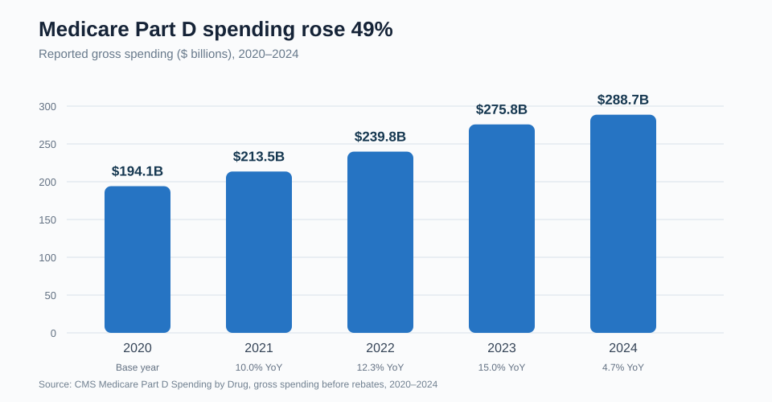
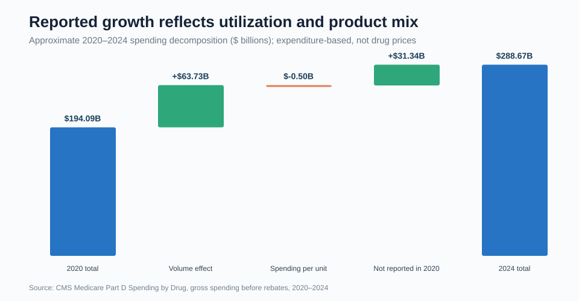

# Medicare Part D Drug Spending Analysis (2020–2024)

**Snowflake SQL • Healthcare Analytics • ETL • Dimensional Modeling • Python**

An end-to-end analytics project using public Centers for Medicare & Medicaid Services (CMS) [Medicare Part D Spending by Drug](https://data.cms.gov/summary-statistics-on-use-and-payments/medicare-medicaid-spending-by-drug/medicare-part-d-spending-by-drug/) data. The pipeline uploads CMS data to Snowflake, reshapes the wide CSV into a long drug/manufacturer/year table, builds analytical marts, and answers nine business questions about spending and utilization.

## Key results from analysis exports

| Measure | Value |
| --- | ---: |
| Source records | 14,536 |
| Drug-level “Overall” records (2024) | 3,625 |
| Gross reported spending in 2020 | $194.09B |
| Gross reported spending in 2024 | $288.67B |
| Growth, 2020–2024 | 48.7% |
| Growth, 2023–2024 | 4.7% |
| Highest-spending drug in 2024 | Eliquis — $20.77B |
| Generic claim share (heuristic) | 87.3% |

*These are saved project findings, not independently revalidated here. CMS spending is reported gross before rebates, not net Medicare spending.*

## Architecture

```
CMS data (CSV)
    ↓
Snowflake internal stage — RAW.CMS_STAGE
    ↓
RAW.SPENDING_BY_DRUG — original fields, VARCHAR
    ↓
STAGING.STG_DRUG_MFR_YEAR — cleaned drug × manufacturer × year
    ↓
MARTS.DIM_DRUG
MARTS.FCT_DRUG_YEAR
MARTS.FCT_MANUFACTURER_YEAR
MARTS.V_DRUG_YEAR
    ↓
Analyses of yearly totals, top drugs, drug classes,
volume/spending-per-unit change, concentration,
brand/generic mix, growth, and manufacturers
```

## Visualizations

### Yearly reported gross spending


### Highest-spending drugs, 2024


### Selected drug-class spending trends


### Spending-growth decomposition


### Brand versus generic shares (heuristic)


### 2024 spending concentration (summary)


*The charts are SVG renditions of the published analysis outputs. The concentration graphic shows an approximate summary rather than the full cumulative concentration curve. The original PNGs and the full concentration export remain in the prepared local ZIP.*

## SQL scripts

- `sql/01_setup.sql`: project role, warehouse, cost monitor, database, schemas and staging area.
- `sql/02_load_raw.sql`: create the wide RAW table and load staged CSV data.
- `sql/03_staging.sql`: convert wide measures (2020–2024) into long yearly observations using `UNION ALL` and `TRY_CAST`.
- `sql/04_marts.sql`: dimension, drug-year and manufacturer-year fact tables, and a convenience view.
- `sql/05_analysis.sql`: nine analytical queries using aggregations, window functions, ranks, and period comparisons.

## How to run

1. Review and execute `sql/01_setup.sql` using a Snowflake role with account administration rights. It creates an X-Small auto-suspending warehouse and a role named `PARTD_ANALYST`.
2. Upload the CMS CSV into `@MEDICARE_PARTD.RAW.CMS_STAGE` using **Snowsight → Add Data → Load files into a Stage**.
3. Verify the file is staged: `LIST @MEDICARE_PARTD.RAW.CMS_STAGE;`.
4. Run `sql/02_load_raw.sql`, `sql/03_staging.sql`, and `sql/04_marts.sql` in sequence.
5. Run `sql/05_analysis.sql` for project findings.

## Methodological limitations

- CMS gross spending is not net spending after rebates or out-of-pocket cost.
- Brand vs generic uses a drug-name comparison proxy, not FDA labeling.
- Therapeutic classes use keyword heuristics and cover only selected drug groups.
- A historical record missing in a 2024-vintage CMS extract is not proof the drug did not exist in an earlier year.
- Expenditure per dosage unit is not a direct measure of transaction price inflation.
- `CREATE OR REPLACE` on the derived staging and marts tables overwrites previous derived content.

## Source

CMS Medicare Part D Spending by Drug, dataset ID `7e0b4365-fd63-4a29-8f5e-e0ac9f66a81b`. [CMS dataset](https://data.cms.gov/summary-statistics-on-use-and-payments/medicare-medicaid-spending-by-drug/medicare-part-d-spending-by-drug/) and [data dictionary](https://data.cms.gov/resources/medicare-part-d-spending-by-drug-data-dictionary).

**File availability:** This repository includes SQL, Python utilities, eight smaller analysis exports and SVG chart previews. The 5.3 MB public CMS source CSV, the full concentration-series export, and the original PNG chart files are retained in the locally prepared ZIP and have not yet been uploaded here. To reproduce the full workflow, download the CSV from CMS or add it from the local archive.
