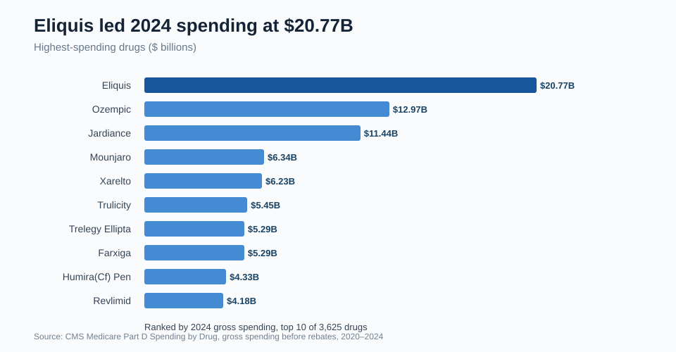
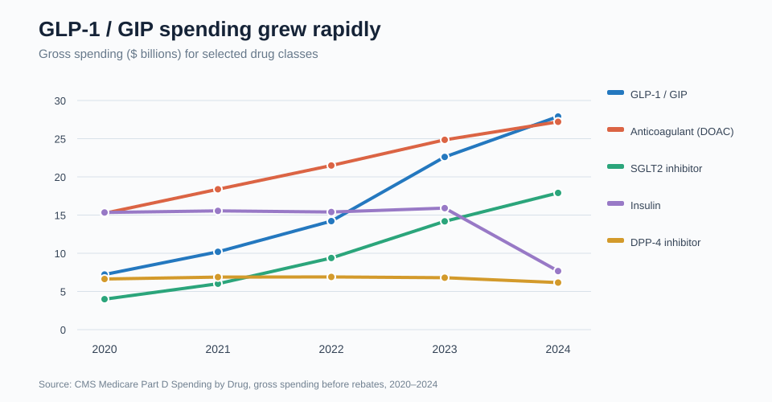
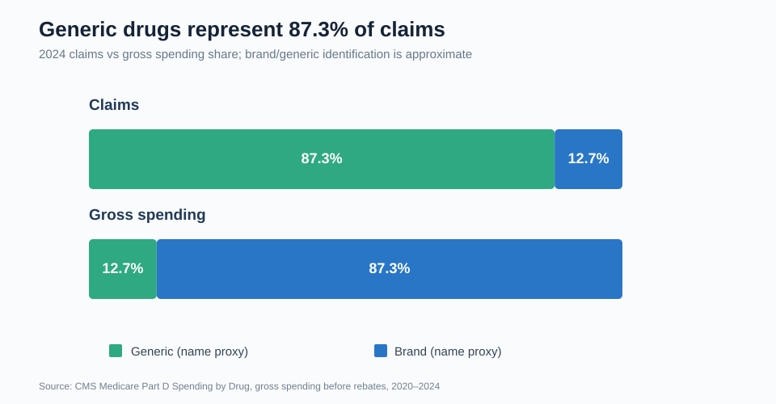
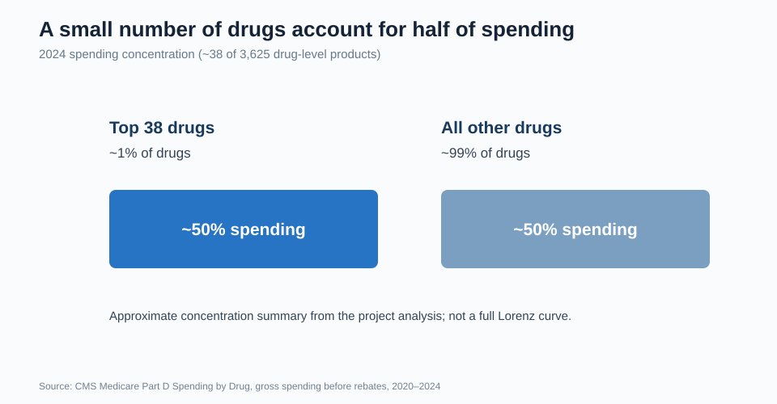

# Medicare Part D Drug Spending Analytics
### An end-to-end Snowflake healthcare analytics project | 2020–2024

**From a public CMS data extract to a dimensional model, SQL analysis, and visual storytelling.**

**[Explore Findings](#key-findings) · [View Charts](#visual-analysis) · [Browse Results](#interactive-results-explorer) · [See SQL Pipeline](#data-architecture) · [Run the Project](#reproduce-this-project)**

---

## Project overview

**Business question:** *How did Medicare Part D prescription-drug spending change from 2020 through 2024, which products drove the growth, and how concentrated was spending across drugs, manufacturers, and therapeutic classes?*

This project analyzes the **CMS Medicare Part D Spending by Drug (2020–2024)** dataset in **Snowflake**. I loaded the source CSV into a RAW layer, converted wide yearly columns into typed longitudinal observations in STAGING, built a small star schema in MARTS, and wrote nine SQL analyses. Python was used to turn saved query outputs into charts.

> [!NOTE]
> The financial measures below represent **reported gross drug spending before manufacturer rebates**. They are not net Medicare expenditure, pharmacy transaction prices, or patient out-of-pocket costs. The brand/generic classification is a **name-based proxy**, not an official FDA designation.

## Executive dashboard

<table>
<tr>
<td align="center" width="33%"><strong>2024 gross spending</strong> <h2>$288.67B</h2>Compared with $194.09B in 2020</td>
<td align="center" width="33%"><strong>Growth since 2020</strong> <h2>+48.7%</h2>Four-year change</td>
<td align="center" width="33%"><strong>2024 claims</strong> <h2>1.71B</h2>1,711.7 million claims</td>
</tr>
<tr>
<td align="center"><strong>2024 drug products</strong> <h2>3,625</h2>CMS “Overall” drug-level records</td>
<td align="center"><strong>Top 10 drugs</strong> <h2>28.51%</h2>Of 2024 gross spending</td>
<td align="center"><strong>Spending concentration</strong> <h2>38 drugs</h2>Account for 50.15% of spending</td>
</tr>
</table>

**Dataset:** 14,536 source rows · **Period:** 2020–2024 · **Total across five years:** $1.212 trillion in reported gross spending · **Analysis:** 9 SQL questions · **Outputs:** curated tables and 6 visualizations.

## Key findings

| Question | Evidence from the analysis | Takeaway |
|---|---|---|
| How much did spending grow? | **$194.09B → $288.67B**, +48.7% from 2020 to 2024 | Gross spending rose substantially over four years. |
| Did growth accelerate? | Growth was **15.0% in 2023** and **4.7% in 2024** | Spending still rose in 2024, but more slowly. |
| Which product led spending? | **Eliquis: $20.77B**, or 7.20% of the 2024 total | One drug represented more than 7% of gross spending. |
| How concentrated is spending? | Top 10 drugs: **28.51% of spending / 4.35% of claims** | Expenditure is disproportionately concentrated. |
| How did selected classes shift? | **GLP-1 / GIP: $7.22B → $27.90B** | This selected category nearly quadrupled between 2020 and 2024. |
| How do generic and brand groups compare? | Generic proxy: **87.3% of claims / 12.7% of spending** | Drug utilization and spending shares are very different. |

<a href="#interactive-results-explorer"><strong>Jump to the expandable results explorer ↓</strong></a>

---

## Visual analysis

### 1. Spending and utilization grew — but at different rates

| Year | Gross spending | Claims | Spending per claim | YoY spending growth |
|:---:|---:|---:|---:|---:|
| 2020 | $194.09B | 1,454.4M | $133.45 | — |
| 2021 | $213.51B | 1,483.3M | $143.95 | +10.0% |
| 2022 | $239.78B | 1,539.2M | $155.78 | +12.3% |
| 2023 | $275.81B | 1,616.7M | $170.60 | +15.0% |
| **2024** | **$288.67B** | **1,711.7M** | **$168.65** | **+4.7%** |

**Finding:** Reported spending increased **48.7%**, while claims increased **17.7%** between 2020 and 2024. The 2024 spending-per-claim figure was slightly lower than in 2023 despite more claims.

<strong>Show the underlying analytical question and result file</strong>

**Question:** How quickly is reported gross Part D spending growing, and is growth due to claim volume alone?

**SQL:** [Yearly totals query](sql/05_analysis.sql) · **Data:** [a1_yearly_totals.csv](results/a1_yearly_totals.csv)

The spending-per-claim measure is **total gross spending divided by total claims**, not a patient payment or manufacturer list price.

### 2. The highest-spending drugs in 2024

| Rank | Drug | Generic name | 2024 gross spending | Share |
|:---:|---|---|---:|---:|
| 1 | **Eliquis** | Apixaban | **$20.77B** | 7.20% |
| 2 | Ozempic | Semaglutide | $12.97B | 4.49% |
| 3 | Jardiance | Empagliflozin | $11.44B | 3.96% |
| 4 | Mounjaro | Tirzepatide | $6.34B | 2.20% |
| 5 | Xarelto | Rivaroxaban | $6.23B | 2.16% |
| 6 | Trulicity | Dulaglutide | $5.45B | 1.89% |
| 7 | Trelegy Ellipta | Combination product | $5.29B | 1.83% |
| 8 | Farxiga | Dapagliflozin propanediol | $5.29B | 1.83% |
| 9 | Humira(Cf) Pen | Adalimumab | $4.33B | 1.50% |
| 10 | Revlimid | Lenalidomide | $4.18B | 1.45% |

**Finding:** The **top three** account for **15.65%** of the total; the **top 10** account for **28.51%**. These same top 10 account for only **4.35%** of 2024 claims.

**Full export:** [Top 15 drugs and claims](results/a2_top_drugs_2024.csv)

### 3. Growth in selected cardiometabolic drug classes

| Selected class | 2020 spending | 2024 spending | Pattern |
|---|---:|---:|---|
| **GLP-1 / GIP** | $7.22B | **$27.90B** | Nearly 3.9× |
| **Anticoagulant (DOAC)** | $15.24B | **$27.21B** | Substantial rise |
| **SGLT2 inhibitor** | $3.99B | **$17.90B** | More than 4× |
| Insulin | $15.34B | $7.67B | Lower gross spending |
| DPP-4 inhibitor | $6.63B | $6.16B | Slight decline |

**Finding:** Among the selected drug classes tracked here, **GLP-1 / GIP** had the highest 2024 gross spending at **$27.90B**, narrowly above DOACs at **$27.21B**. Insulin spending fell markedly in 2024, while insulin claims remained near 23.5 million. These descriptive data do not establish the reasons for that change.

*Class membership is assigned using keyword rules on generic names. These are illustrative categories, not a complete therapeutic taxonomy.*

**Full export:** [25 drug-class/year observations](results/a3_class_trend.csv)

### 4. What contributed to 2020–2024 growth?

| Component | Change in gross spending |
|---|---:|
| Additional dosage units for products observed in both years | **+$63.73B** |
| Change in spending per dosage unit for those products | **−$0.50B** |
| Spending for products not reported in 2020 | **+$31.34B** |
| **Approximate change explained** | **+$94.57B** |

This arithmetic roughly reconciles the **$94.58B** increase in the annual total; the $0.01B difference is rounding.

<strong>Show how the decomposition was calculated</strong>

For drugs with observed spending and nonzero dosage units in both years:

\`\`\`text
Volume component =
    (Units_2024 − Units_2020) × (Spending_2020 / Units_2020)

Spending-per-unit component =
    (Spending_2024 / Units_2024
     − Spending_2020 / Units_2020) × Units_2024
\`\`\`

Spending for products **without 2020 observations** is shown separately. Those products should **not automatically be interpreted as newly launched drugs**.

This is an expenditure decomposition, **not** a causal estimate of inflation, manufacturers' prices, or rebates.

[Open decomposition results](results/a4_price_volume.csv) · [View SQL](sql/05_analysis.sql)

### 5. Brand versus generic: claims and spending tell different stories

| Proxy category | Drug products | Share of claims | Share of gross spending | Gross spending per claim |
|---|---:|---:|---:|---:|
| **Generic** | 1,176 | **87.3%** | 12.7% | $24 |
| **Brand** | 2,449 | 12.7% | **87.3%** | $1,156 |

**Finding:** Products identified as generics through the project's name-matching proxy represented the large majority of claims but a much smaller share of gross spending.

<strong>Read the classification caveat</strong>

The SQL considers a drug *generic* when the first word of its normalized brand name matches the first word of its generic name. This heuristic may misclassify products and should not be presented as FDA-validated brand/generic status.

[Open classification results](results/a6_brand_vs_generic_2024.csv)

### 6. Drug spending is highly concentrated

| Top ranked products | % of all 3,625 products | Cumulative spending share | Cumulative claims share |
|---|---:|---:|---:|
| 1 | 0.03% | 7.20% | 1.41% |
| 10 | 0.28% | 28.51% | 4.35% |
| **38** | **1.05%** | **50.15%** | **5.82%** |
| 100 | 2.76% | 66.80% | 13.45% |
| 363 | 10.01% | 87.44% | 58.30% |

**Finding:** Just **38 products (approximately 1% of products)** accounted for **over half of 2024 gross spending**. The concentration chart is a simplified visual summary; the table is computed from the source project's full ranked concentration export.

[Explore concentration checkpoints](results/a5_concentration_milestones_2024.csv)

---

## Additional results

<strong>Top manufacturers, 2024 — show result table</strong>

| Rank | Manufacturer name as reported | Gross spending | Products |
|:---:|---|---:|---:|
| 1 | BMS Primarycare | $22.28B | 21 |
| 2 | Novo Nordisk | $18.56B | 45 |
| 3 | Boehringer Ing. | $18.07B | 28 |
| 4 | Eli Lilly & Co. | $16.67B | 59 |
| 5 | Astrazeneca | $13.09B | 33 |
| 6 | Abbvie US LLC | $12.37B | 33 |
| 7 | Glaxosmithkline | $11.34B | 41 |
| 8 | Janssen Pharm. | $9.44B | 18 |
| 9 | Novartis | $9.43B | 57 |
| 10 | Pfizer US Pharm | $7.85B | 62 |

**Source:** [a9_top_manufacturers_2024.csv](results/a9_top_manufacturers_2024.csv). Manufacturer labels are retained as reported and are not normalized to parent corporations.

<strong>Fastest-growing drug spending, 2020–2024 — show result table</strong>

| Drug | 2020 spending | 2024 spending | Absolute increase |
|---|---:|---:|---:|
| Ozempic | $1.46B | $12.97B | **+$11.51B** |
| Eliquis | $9.94B | $20.77B | **+$10.84B** |
| Jardiance | $2.38B | $11.44B | **+$9.06B** |
| Farxiga | $0.74B | $5.29B | +$4.55B |
| Trelegy Ellipta | $1.49B | $5.29B | +$3.81B |

**Source:** [a7_fastest_growing.csv](results/a7_fastest_growing.csv). Includes drugs reported in both comparison years; ranked by absolute dollar increase, not percentage growth.

<strong>Spending per dosage unit — show annualized median changes</strong>

Among drugs with at least **$50 million in 2024 gross spending**, and positive spending per dosage unit in both years:

| Name-based category | Products analyzed | Median annual change | % with increase |
|---|---:|---:|---:|
| Brand | 341 | **+4.0%** | 86.8% |
| Generic | 168 | **−9.3%** | 6.5% |

**Source:** [a8_unit_price_inflation.csv](results/a8_unit_price_inflation.csv)

This is a descriptive change in **CMS gross spending per dosage unit**. It does not directly measure inflation or out-of-pocket costs.

---

## Interactive results explorer

GitHub README files do not run arbitrary JavaScript dashboards, so this report uses **clickable charts, links, and expandable sections** to make all nine analysis questions easy to explore. Open any section to see its output and supporting query.

<strong>Q1 · How did annual Part D spending and claims change?</strong>

**Result:** $194.09B in 2020 → $288.67B in 2024, while claims increased by 17.7%.  
[Results CSV](results/a1_yearly_totals.csv) · [SQL](sql/05_analysis.sql) · [Chart](charts/01_total_spending.svg)

<strong>Q2 · Which 2024 drugs generated the most spending?</strong>

**Result:** Eliquis ranked first at $20.77B; Ozempic and Jardiance followed.  
[Results CSV](results/a2_top_drugs_2024.csv) · [SQL](sql/05_analysis.sql) · [Chart](charts/02_top10_drugs_2024.svg)

<strong>Q3 · Which selected drug classes grew or declined?</strong>

**Result:** GLP-1 / GIP grew from $7.22B to $27.90B; SGLT2 inhibitors from $3.99B to $17.90B.  
[Results CSV](results/a3_class_trend.csv) · [SQL](sql/05_analysis.sql) · [Chart](charts/03_drug_class_trends.svg)

<strong>Q4 · What is the expenditure decomposition of growth?</strong>

**Result:** +$63.73B dosage-unit volume effect, −$0.50B spending-per-unit effect, +$31.34B for products with no 2020 observation.  
[Results CSV](results/a4_price_volume.csv) · [SQL](sql/05_analysis.sql) · [Chart](charts/04_growth_decomposition.svg)

<strong>Q5 · Is 2024 spending concentrated among a few drugs?</strong>

**Result:** The top 38 products represent 50.15% of gross spending but only 5.82% of claims.  
[Concentration checkpoints](results/a5_concentration_milestones_2024.csv) · [SQL](sql/05_analysis.sql) · [Chart](charts/06_concentration.svg)

<strong>Q6 · What is the brand/generic spending split?</strong>

**Result:** The generic name-based proxy has 87.3% of claims and 12.7% of spending.  
[Results CSV](results/a6_brand_vs_generic_2024.csv) · [SQL](sql/05_analysis.sql) · [Chart](charts/05_brand_vs_generic.svg)

<strong>Q7 · Which drugs had the largest dollar increases?</strong>

**Result:** Ozempic +$11.51B, Eliquis +$10.84B, Jardiance +$9.06B.  
[Results CSV](results/a7_fastest_growing.csv) · [SQL](sql/05_analysis.sql)

<strong>Q8 · How did reported spending per unit change?</strong>

**Result:** The median annualized change was +4.0% among the brand-proxy group and −9.3% among the generic-proxy group, subject to the $50M threshold.  
[Results CSV](results/a8_unit_price_inflation.csv) · [SQL](sql/05_analysis.sql)

<strong>Q9 · Which manufacturers had the highest reported spending?</strong>

**Result:** BMS Primarycare $22.28B, Novo Nordisk $18.56B, and Boehringer Ing. $18.07B.  
[Results CSV](results/a9_top_manufacturers_2024.csv) · [SQL](sql/05_analysis.sql)

---

## Data architecture

\`\`\`mermaid
flowchart LR
    A["CMS Medicare Part D 2020–2024 CSV"] --> B["Snowflake internal stage RAW.CMS_STAGE"]
    B --> C["RAW SPENDING_BY_DRUG"]
    C --> D["STAGING STG_DRUG_MFR_YEAR"]
    D --> E["MARTS DIM_DRUG"]
    D --> F["MARTS FCT_DRUG_YEAR"]
    D --> G["MARTS FCT_MANUFACTURER_YEAR"]
    E --> H["MARTS V_DRUG_YEAR"]
    F --> H
    F --> I["9 SQL analyses"]
    G --> I
    H --> I
    I --> J["CSV results Python charts README"]
\`\`\`

| Layer | Main object | Purpose |
|---|---|---|
| **RAW** | \`SPENDING_BY_DRUG\` | Preserve source text values and file-load metadata |
| **STAGING** | \`STG_DRUG_MFR_YEAR\` | Reshape 2020–2024 wide columns into typed yearly records |
| **MARTS** | \`DIM_DRUG\` | Drug attributes, surrogate key, approximate classification |
| **MARTS** | \`FCT_DRUG_YEAR\` | Drug-level annual spending, claims, units and beneficiaries |
| **MARTS** | \`FCT_MANUFACTURER_YEAR\` | Manufacturer-year aggregated measures |
| **BI VIEW** | \`V_DRUG_YEAR\` | Reusable analysis-ready drug-year data |

### Techniques demonstrated

\`Snowflake\` · \`SQL\` · \`ETL/ELT\` · \`CSV staging\` · \`COPY INTO\` · \`TRY_CAST\` · \`UNION ALL\` · \`Window functions\` · \`QUALIFY\` · \`Star schema\` · \`Data quality checks\` · \`Python\` · \`Data visualization\` · \`Role-based access control\`

## Repository map

| Location | What's inside |
|---|---|
| [\`sql/01_setup.sql\`](sql/01_setup.sql) | Account role, X-Small warehouse, auto-suspend, resource monitor, schemas, internal stage |
| [\`sql/02_load_raw.sql\`](sql/02_load_raw.sql) | Wide RAW table and stage-to-table ingestion |
| [\`sql/03_staging.sql\`](sql/03_staging.sql) | Wide-to-long SQL transformation with type conversion |
| [\`sql/04_marts.sql\`](sql/04_marts.sql) | Drug dimension, two fact tables, BI view and QA |
| [\`sql/05_analysis.sql\`](sql/05_analysis.sql) | Nine SQL questions and their analysis logic |
| [\`results/\`](results) | Eight full summary exports + one concentration milestones extract |
| [\`charts/\`](charts) | Six SVG chart previews for GitHub |
| [\`scripts/\`](scripts) | Python helper utilities and field metadata |

## Data quality and interpretation

<strong>Data checks and analytical assumptions</strong>

- The project checks duplicate drug-year combinations and negative spending after MARTS construction.
- The 2024 drug-level analysis uses CMS manufacturer name \`Overall\` to avoid counting manufacturer-detail rows in the aggregate totals.
- The STAGING transformation uses \`TRY_CAST\` and excludes unreported year/product combinations where spending is null.
- Brand/generic and selected drug-class assignments use string rules; they can misclassify some drugs.
- Manufacturer names are not normalized into corporate parent entities.
- The 2024-vintage extract may omit products that were no longer reported by 2024, limiting historical comparisons.
- Changes in spending per unit reflect expenditure measures and may incorporate product-mix and reporting differences. They are **not** direct evidence of manufacturer price increases.
- Rounding explains small differences when summing displayed decomposition components.

## Data source and acknowledgment

**U.S. Centers for Medicare & Medicaid Services (CMS)** — [Medicare Part D Spending by Drug](https://data.cms.gov/summary-statistics-on-use-and-payments/medicare-medicaid-spending-by-drug/medicare-part-d-spending-by-drug/), dataset ID \`7e0b4365-fd63-4a29-8f5e-e0ac9f66a81b\`. [CMS data dictionary](https://data.cms.gov/resources/medicare-part-d-spending-by-drug-data-dictionary).

*This is an independent analytical portfolio project. It is not an official CMS publication and does not imply CMS endorsement.*

---

**Explore the project:** [SQL pipeline](sql) · [Results](results) · [Charts](charts) · [Back to top](#medicare-part-d-drug-spending-analytics)

